<picture>
  <source media="(prefers-color-scheme: dark)" srcset="assets/banner-dark.svg">
  
</picture>

Hi, I'm LeenHawk. I write Rust, mostly LLM API plumbing, and lately I've been trying to get Tauri running on OpenHarmony.

写 Rust，做点 LLM 网关，最近在折腾 Tauri 上鸿蒙。

<picture>
  <source media="(prefers-color-scheme: dark)" srcset="assets/stats-dark.svg">
  
</picture>

- [gproxy](https://github.com/LeenHawk/gproxy): an OpenAI / Claude / Gemini compatible gateway
- [sgproxy](https://github.com/LeenHawk/sgproxy): a small Claude Code proxy on Cloudflare Workers
- [tauri-harmony](https://github.com/LeenHawk/tauri-harmony): a Tauri build toolchain for OpenHarmony

Occasionally I send patches to [Tauri](https://github.com/tauri-apps/tauri/pulls?q=author%3ALeenHawk), [UPX](https://github.com/upx/upx/pulls?q=author%3ALeenHawk), [clewdr](https://github.com/Xerxes-2/clewdr/pulls?q=author%3ALeenHawk) and a few others.

<picture>
  <source media="(prefers-color-scheme: dark)" srcset="https://raw.githubusercontent.com/LeenHawk/LeenHawk/output/snake-dark.svg">
  
</picture>
